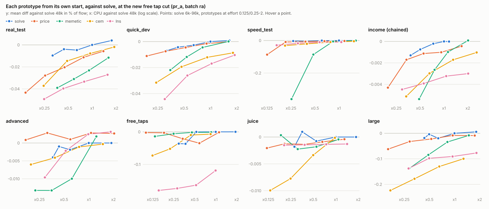
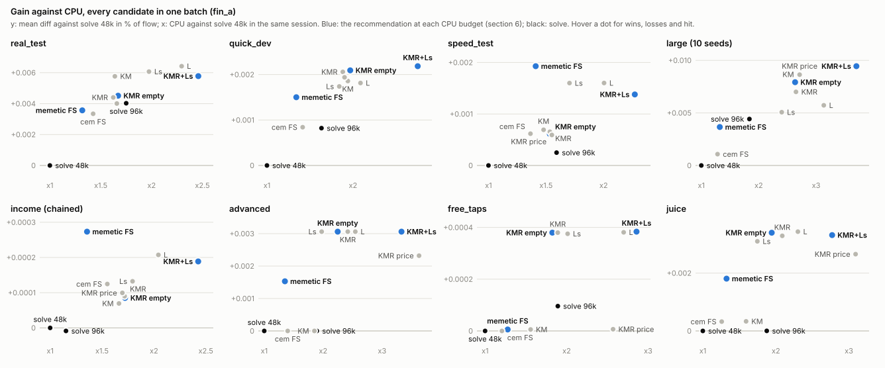
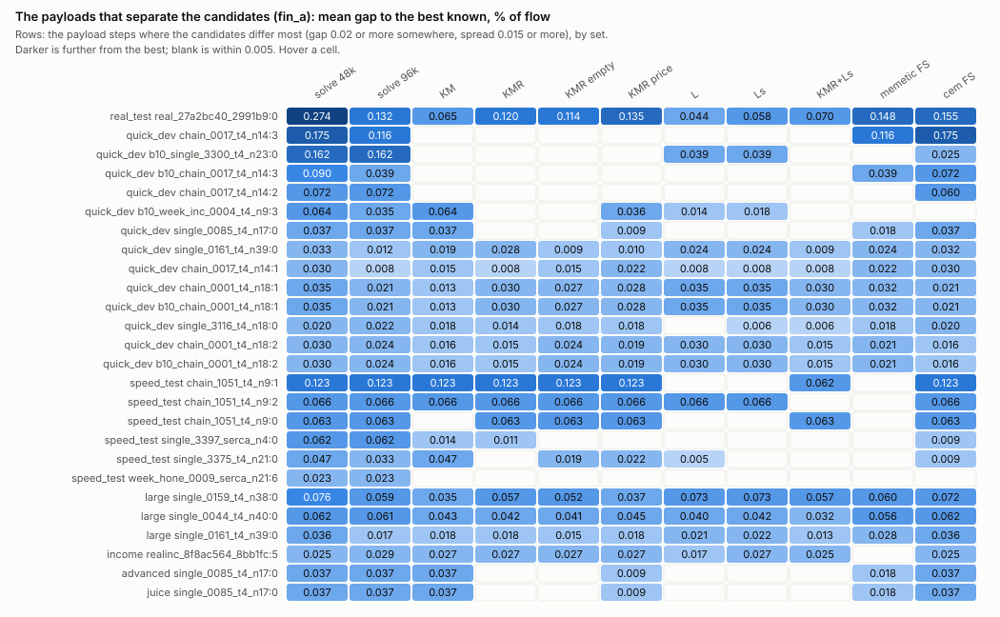

# Iteration 2: final report

**Verdict: keep `solve`'s start and annealing, and spend extra CPU on a tail after it, never on more iterations.** The best tail at each budget (section 6):

- about x1.35: `memetic`'s generations from `solve`'s result;
- about x1.5–2: the kick loop with `mem_polish` and the rebuild kick's emptying half (`rebuildempty`);
- about x2.5–3.7: that plus the screened surrogate loop.

None of these loses a payload on any set. The mean gains are small (at most 0.01% of flow on any set), and each comes from a few payloads per set that `solve` leaves 0.02–0.27% short. No production default was changed.

All numbers are in % of flow, against production `solve` (48k iterations) in the same batch, unless marked otherwise. Figures are SVGs in `figs/`; hover a mark for its numbers (in a browser). The script that draws them is `scripts/figs.py`.

## 1. What iteration 2 did

**The aim** was to learn what makes each iteration 1 prototype good or bad, piece by piece, rather than to build a better optimizer. Each prototype (`price`, `surrogate`, `memetic`, `cem`, `lns`) had its own review. A review made controlled comparisons (one part changed at a time), switched each piece off in the prototype, and swapped single pieces into production `solve` as knobs that are off by default. Each review ends in a list of pieces with evidence, in `iteration2/<algo>/report.md`. Settled knowledge is in `AI notes/Calculator core/Optimizer lab results.md` and `Optimizer tried.md`.

**How it was measured.**

- The arena optimizes each payload from cold (income chained, each step from the last), at 16 runs at a time on one machine, with one batch at a time.
- **Sets:**

  | Set | Payload steps | Seeds | `solve` CPU per run |
  |---|---|---|---|
  | real_test | 38 | 10 | 5.1 s |
  | quick_dev | 349 | 3 | 3.5 s |
  | speed_test | 215 | 3 | 3.8 s |
  | `large` | 10 | 3 (10 in the final batch) | 35 s |
  | income (chained) | 286 | 3 | 7.5 s |
  | advanced, free_taps, juice | 12 each | 3 | 5–10 s |
  | small | 20 | 3 | 0.2 s |

- **Diff:** the mean over payloads of the metric difference, in % of flow. **Wins/losses:** payloads that moved by more than 0.01. **Hit:** runs within 0.01 of the best result known. **CPU:** the sum of run CPU seconds against `solve` in the same session; it compares only inside one batch (the machine drifts 2–5% between batches).
- **Repeat checks.** Every new build had to repeat the stored `cut_a` runs exactly, metrics and evaluation counts, before a batch ran; every batch had to pass `tools/logcheck.py` (all jobs done, no died runs, no Monte Carlo failures).
- **Noise.** Effects under about 0.01 are noise unless they repeat. `single_0159` (`large`) and `real_27a2bc40` (real_test) swing between runs and are read with care.

**Scale.** About 778,000 optimize runs and 1,430 CPU-hours over 20 snapshots:

| Review | Snapshots | Report |
|---|---|---|
| `price` (old cut), then re-run at the new cut | `i2a`–`i2i`, `pr_a` | `price/report.md` |
| The free tap cut | `cut_a` | `free_tap_cut/report.md` |
| `surrogate` | `sur_a`–`sur_g` | `surrogate/report.md` |
| `memetic` | `mem_a`, `mem_b` | `memetic/report.md` |
| `cem` | `cem_a`, `cem_b` | `cem/report.md` |
| `lns` | `lns_a`, `lns_b` | `lns/report.md` |
| This report | `fin_a` | here |

**Two changes went into production during the iteration:** `response_points` 128 (from 16), and the scaled free tap cut (`skip_weights`, 1e-4 scaled by the mass outside the likeliest outcome). Every number here is at both.

## 2. Each prototype from its own start

At the new cut (`pr_a`, batch `ra`), against `solve` from 6k to 96k iterations. `surrogate`'s own curve was taken at the old cut only (`lab_r1`).

- **No prototype beats `solve` from its own start at matched CPU** on the main sets. `memetic` at effort 2 comes closest (quick_dev +0.0001 at x1.61); `price` is level at about x1.6 on quick_dev and ahead only on `advanced`.
- **`cem` and `lns` are far behind on `large`** at every effort (-0.08 to -0.22), and `lns` on `free_taps` (-0.12 to -0.18, from one order basin).
- **More effort does not close the gap for `lns`:** a stall rule ends 75–100% of its runs early.

Every prototype's own start was its weakness. Started from `solve`'s result instead (`fromsolve`), `price`, `memetic`, `cem` and `lns` each lose nothing, and each reaches payloads `solve` misses.

## 3. What each review found

| Prototype | Verdict | What carries it | What carries nothing |
|---|---|---|---|
| `price` | Take pieces, not the algorithm | Its **kick loop**: kick the best, polish, keep if better, until 32 kicks in a row gain nothing. Each kick type carries a set: adv `large`, chest real_test, window quick_dev and the order basins. Now in `solve` (`kick_stall=32`) | Its namesake, the shadow price trajectories; its start |
| `surrogate` | Take one piece | A **re-plan between a kick and the polish** (`sur_stall=32`, the surrogate loop L): every normal upgrade re-plans, with order moves among the plans, before `order_polish` can put the order back | Calibration, Edgeworth terms, a model-free price kick; the model adds only a little through its error |
| `memetic` | Take two pieces | Its **polish** (`mem_polish`): paired order moves, one upgrade out of the free taps and one in, retried with both re-planned. Its **generations from `solve`'s endpoint**: children's responses after recombination | Chunked responses, fresh prices, price seeds, runs of 2–3 |
| `cem` | Take no piece of its model | Its **restarts** from a cheap start, each a short descent and a polish. A cap of 10 places in its order polish was most of its `large` loss | The cross-entropy model (refit, piece-type factor) |
| `lns` | Take one piece | Its **rebuild of a piece type** (emptied, or re-planned at noisy prices, then responses in turn), now a kick type in `solve` (`rebuild`) | Its ladder of prices (iteration 1's credit was misread), record-to-record acceptance, adaptive weights, its order-move caps |

## 4. What makes a result good

The reviews converge on four kinds of basin that `solve`'s annealing leaves, and one move that reaches each.

| Basin | Example payloads | What reaches it | Evidence |
|---|---|---|---|
| **Free tap order**: an upgrade in or out of the free taps, or a long reach | `chain_0017:2/3`, `b10_chain_0017:3`, `b10_single_3300`, `single_0161` | The window kick with a re-plan of the moved upgrades; memetic's paired in/out moves with a re-plan (`mem_polish`); an uncapped insertion polish | `price` 8–10, `memetic` 4, `cem` 3 |
| **Joint re-split of a shared juice** across a piece type: each upgrade's juice tail is best with the others fixed | `single_3375`, `single_0085`, `b10_week_inc_0004:3`, `single_3397` | Re-planning the whole piece type at once, then responses in turn: lns's rebuild kick; also memetic's generations, cem's restarts, the surrogate loop (partly) | `lns` 5, `memetic` 3, `cem` 4, `surrogate` 9 |
| **Re-plan after a kick**: the kick's new basin needs every plan to follow before the polish | `chain_1051`, `single_3116`, `real_27a2bc40` | The surrogate loop's descent (order moves among the plans) | `surrogate` 6–10 |
| **Chest amounts off the grid** | `single_1104`, `single_1166` | Random amounts beside the halving grid (`chestboth`); `solve` reaches most through its random-amount moves in the annealer | `price` 5–8, `lns` 4 |

Two general lessons:

- **A kick needs a re-plan before the greedy repair.** Otherwise `order_polish` puts a shuffled window straight back. Every winning move in the iteration moves several plans together.
- **Starts matter less than reach.** No prototype's own start helped; all of them lost to `solve`'s start on the same payloads (advanced plans with normal ones, plans only the annealer finds, chest amounts off a grid).

## 5. The candidates in one batch

Snapshot `fin_a`: every candidate in one session per set, so CPU compares directly; `large` at 10 seeds. Every run `fin_a` shares with a stored snapshot (`cut_a`, `pr_a`, `sur_g`, `mem_b`, `cem_b`, `lns_a`, `lns_b`) repeated exactly, metric and evaluation count; `logcheck` passed (9 jobs, none bad). Run time 7.1 h (02:34–09:38).

**Candidates.** K = `kick_stall=32`, M = `mem_polish=true`, R = the `rebuild` kick type added to `window+chest+adv+piece`. L = the surrogate loop (`sur_stall=32,sur_kinds=rand+chest+empty,lab_on=randreach`); Ls = L with `sur_screen=true`. Memetic FS = `algo=memetic,lab_effort=1,lab_on=fromsolve,lab_off=oreplan`; cem FS = `algo=cem,lab_effort=0.5,lab_on=fullreach+fromsolve+ownstart`.

Mean diff against `solve` 48k (% of flow) and CPU ratio; the last column is the hit rate on the three 12-payload sets (`solve`: 94 / 94 / 97).

| Candidate | real_test | quick_dev | speed_test | `large` (10 seeds) | income | advanced / juice / free_taps hit |
|---|---|---|---|---|---|---|
| `solve` 96k | +0.0040 x1.75 | +0.0008 x1.63 (1 loss) | +0.0002 x1.59 | +0.0044 x1.84 | 0 x1.15 | 94 / 94 / 97 |
| KM | +0.0058 x1.64 | +0.0019 x1.94 | +0.0007 x1.48 | +0.0087 x2.71 | +0.0001 x1.66 | 94 / 94 / 97 |
| KMR | +0.0044 x1.62 | +0.0021 x1.88 | +0.0007 x1.53 | +0.0070 x2.65 | +0.0001 x1.72 | 100 / 100 / 100 |
| **KMR empty** | +0.0045 x1.67 | +0.0021 x1.97 | +0.0006 x1.53 | +0.0079 x2.63 | +0.0001 x1.72 | 100 / 100 / 100 |
| KMR price | +0.0040 x1.66 | +0.0019 x1.90 | +0.0006 x1.55 | +0.0086 x2.71 | +0.0001 x1.70 | 97 / 97 / 97 |
| L | +0.0064 x2.30 | +0.0018 x2.09 | +0.0016 x2.00 | +0.0057 x3.13 | +0.0002 x2.04 | 100 / 100 / 100 |
| Ls | +0.0061 x1.97 | +0.0017 x1.84 | +0.0016 x1.70 | +0.0051 x2.40 | +0.0001 x1.79 | 100 / 100 / 100 |
| **KMR+Ls** | +0.0058 x2.46 | +0.0022 x2.75 | +0.0014 x2.27 | +0.0094 x3.70 | +0.0002 x2.43 | 100 / 100 / 100 |
| **memetic FS** | +0.0036 x1.32 | +0.0015 x1.34 | +0.0019 x1.41 | +0.0037 x1.32 | +0.0003 x1.36 | 97 / 97 / 97 |
| cem FS | +0.0033 x1.43 | +0.0008 x1.41 | +0.0006 x1.36 | +0.0011 x1.28 | +0.0001 x1.55 | 94 / 94 / 97 |

On `small` every candidate ties `solve`. Hit on quick_dev: `solve` 95.5%, KMR+Ls 98.1%, KMR empty 97.9%. Hit on `large`: `solve` 51%, KMR+Ls 68%, KMR empty 65%, KM 62%.

**Findings.**

- **Running `solve` longer is the worst use of CPU.** At x1.6–1.9, 96k gains less than some loop that costs less on real_test, quick_dev and speed_test, and it loses one quick_dev payload. On `large` it is level with memetic FS, which costs x1.32.
- **The rebuild kick works through its emptying half.** KMR empty matches KMR on every set within noise and reaches `single_0085` (advanced, juice, quick_dev) and `single_0012` (free_taps) on every seed. The noisy-price half alone reaches `single_0085` only in part (0.009 short) and costs the most CPU on advanced and juice (x3.6, x3.1).
- **KM against KMR on `large` is still unsettled.** At 10 seeds KM leads by 0.0017, and all of it is `single_0159`: KM is 0.035 short, KMR 0.057 short, about 1.2 standard errors apart. KM gets out of that payload's 0.094/0.111 basins on 8 seeds of 10, KMR on 5. On the other nine `large` payloads KMR is level or ahead. The price half alone does as well as KM there (0.0375). It may be that the rebuild kick's share of kicks thins the `adv` kick, but that is not shown.
- **KMR+Ls reaches the most payloads.** It is best on quick_dev and `large`, with the highest hit rate. On real_test and speed_test it gains less than Ls alone, so the two loops do not simply add up. Its `single_0159` runs equal KMR's exactly: after KMR, the surrogate loop finds nothing more there.
- **Ls matches L for 15–25% less CPU** on every set except `large` (+0.0051 against +0.0057).
- **Memetic FS is the cheapest gain.** It gains on every set at x1.3–1.4, and it is the best of all candidates on speed_test and income. It misses the free tap order basin (`chain_0017:3`, 0.116 short).
- **Cem FS does less than memetic FS on every set** at about the same CPU.
- **Each candidate reaches its own basins** (the heatmap; section 4 has the basins):
  - `chain_1051` (speed_test, a re-plan after a kick): only the surrogate loop and memetic FS reach it.
  - `b10_single_3300` (quick_dev, free tap order): the kick loop reaches it; L and Ls stop 0.039 short.
  - `single_0085` (a joint re-split): the emptying rebuild and the surrogate loop reach it; memetic FS gets halfway.
- **Some payloads stay hard for every candidate.**
  - `real_27a2bc40` (real_test) has a 0.2–0.6 tail on a few seeds for every candidate except L and Ls (0.044 and 0.058 short, steady). Real_test's ranking is that one payload.
  - `single_0159` and `single_0044` (`large`) stay 0.03–0.06 short everywhere.
  - Income (chained) barely moves (at most +0.0003).

## 6. Recommendation

None of this changes a production default. The choice is yours; by CPU budget against `solve` 48k:

| Budget | Take | Why | Cost to adopt |
|---|---|---|---|
| x1 | `solve` as is | Means are within 0.01% of flow | none |
| about x1.35 | memetic's generations from `solve`'s result | Gains on every set and never loses; the best gain per CPU; best on speed_test and income | It is a lab algorithm (`algo=memetic`, `fromsolve`); production would need the generations ported into `solve`'s tail |
| about x1.5–2 | `kick_stall=32,mem_polish=true,kick_types=window+chest+adv+piece+rebuildempty` | Already knobs in `solve`. It reaches three of the four basins and every 12-payload set at 100%. Choose Ls instead if speed_test and real_test matter more than quick_dev and `large` | Set three knobs. Plain `rebuild` can give way to `rebuildempty`; the price half can go |
| about x2.5–3.7 | the above plus Ls (`sur_stall=32,sur_kinds=rand+chest+empty,sur_screen=true`) | Reaches all four basins, with the highest hit rate on quick_dev and `large` | Knobs only, but the surrogate code moves into production. It was measured with plain `rebuild`, not `rebuildempty` (section 7) |

Never spend CPU on `max_iters` instead: the 96k row is behind a cheaper candidate on every set except `large`, where it ties memetic FS.

## 7. Not answered

- **KMR empty + Ls together** was not run (the table's KMR+Ls has plain `rebuild`). Given the KMR empty results it should do no worse, but that is untested. Memetic's generations after the kick loop were not run either.
- **`single_0159`, KM against KMR:** about 1.2 SE apart at 10 seeds. Settling it would take about 40 seeds.
- **Why L and Ls are steady on `real_27a2bc40`** when every other candidate has a 0.2–0.6 tail.
- **Porting memetic's generations into `solve`:** not done. Their cost and gain as a `solve` tail, rather than as `algo=memetic`, are unknown.
- **Fixed time budget:** every comparison here is at a CPU ratio. No candidate was run under a wall-clock limit, as the app might impose.
- **Pruning:** the lab code keeps every switch the reviews tried, including those that carry nothing (`Optimizer tried.md`). Removing them is left open.

## 8. Reproducing

- Runs are in `arena_data/lab/runs.sqlite` under the snapshots named above; each snapshot's exe is in `target/arena/bin/`.
- The final batch: `pnpm lab iteration2/report/a`, then `iteration2/report/a_large` (queues in `runs/`).
- Figures: `python arena_data/lab/iteration2/report/scripts/figs.py` (repo root), from the cached dump of `tools/dump.py`.
